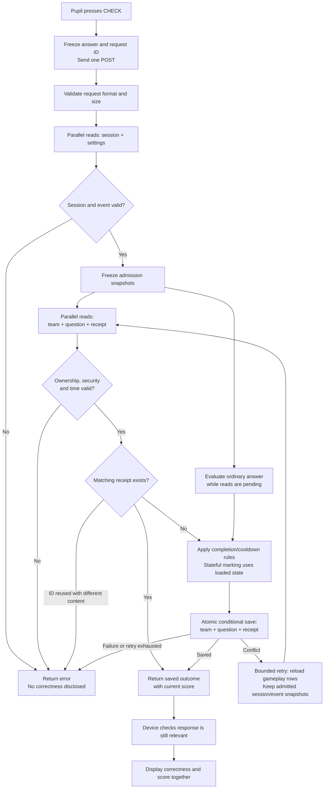

# Fast, confirmed question checking

Status: handoff ready; implementation not started by this task

## Objective and authority

Optimise CHECK-to-confirmed-feedback latency, including the durable score commit: acceptable under 1 second, median under 500 ms, ideal under 300 ms. Report p50, p95, maximum and the fraction exceeding 1 second; do not reinterpret the 1-second requirement as merely a minimum observed latency. No guarantee is possible from local timing alone.

The user explicitly selected removal of the CHECK rate limiter, per-request layout/maintenance check, legacy attempt lookup and repeated authentication/settings reads. Retain initial authentication, ownership/security checks, event timing, cooldown/completion checks, canonical receipts and conditional atomic writes. An initially admitted request may finish after concurrent logout or event-reset publication. Team changes remain transactionally fenced.

This is an implementation handoff, not evidence of implementation or deployment. See [implementation ticket](issues/01-implementation.md). This work refines the existing [API performance effort](../api-performance/spec.md); do not replace its storage, diagnostics or reset work.

## Current foundation and scope

- The working tree already implements event partitions in `api/src/layout.mjs`: `event!<eventId>`, summary rows `summary!<teamId>`, question/receipt rows `team!<teamId>!q-<questionId>` and `team!<teamId>!receipt-<requestId>`. Use these helpers rather than inventing a second layout.
- Event configuration remains authoritative in `system/settings`. One point read supplies the event snapshot. Do not introduce a duplicate event row or another schema migration to save a read that is already keyed.
- Optimise `POST submit` (CHECK); teacher CHECK remains isolated and unscored. Leave login, recovery, practical saving, timed/GC action endpoints and roster contracts unchanged. The four removals are endpoint-specific, not a blanket deletion of shared protections.
- Existing server/browser telemetry is the foundation. The recorded 22–26 ms local-machine Azure point-read sample is evidence for reducing sequential waits, not a measurement of managed Functions or pupil round trips. Existing benchmark question reads are not a CHECK baseline.
- Preserve uncommitted work. Git HEAD object access failed during planning; do not reset or repair Git as part of this task. Reinspect current files before editing because related work may continue.

## Required pipeline

### 1. Prepare and admit

The browser keeps its current single request, frozen answer/request ID and duplicate-click guard. Validate origin, JSON content type, body size/depth, identifier and answer shape before expensive work. Never accept browser role, score, authority or time.

On the warm competitor path, start exactly two point reads together: session by hashed cookie token and `system/settings`. Validate role, expiry, claimed event/team binding, event existence/year and theory availability. Derive team keys from the authenticated session; a supplied event ID must match. Establish immutable request-local session/event snapshots. No session/settings caching across HTTP requests.

Do not call helper chains that reread these records. A new HTTP retry authenticates afresh, but an internal transaction retry reuses these snapshots. Recheck session expiry and the accepted event's clock window in memory before replay/commit and each internal retry. Preserve one server-owned `acceptedAt` for a submission; use the current server clock for expiry/window gates. Preserve the existing accepted-event snapshot rule: concurrent End/schedule edits do not replace the accepted event configuration mid-request.

### 2. Load gameplay state and evaluate

Start team summary, selected question and canonical receipt point reads together. Validate team owner, claim generation, removed state, year and ACTIVE security status before exposing any result. Capture the initial accepted security epoch and claim generation; retries must still match them, so a breach/recovery cycle cannot legitimise an old operation.

Ordinary correctness evaluation may run while these reads are outstanding. Extract a pure correctness function from ordinary marking: validated frozen input and deployed marking rules in, correctness out; no score, cooldown, random values, storage or UI effects. Preserve incomplete-submission exceptions, malformed-drawing behaviour and private per-part details. Evaluate once per request and reuse only this state-independent result on internal retries. Synchronous JS overlaps pending I/O, not CPU threads; do not add worker-thread machinery in this phase.

Timed/GC and other state-dependent reducers wait for the question row and are recomputed against fresh state on conflict. Apply ordinary correctness only after checking the loaded completion/cooldown state. A missing question row has the existing not-started meaning and is created conditionally; pre-population is not required for speed.

Preserve receipt precedence using settled-result handling: an authorised matching receipt can replay even if the speculative question read failed. A different fingerprint is a conflict. A failed session/settings/team read cannot be bypassed by a receipt. Replay the retained outcome with the current team score/server time, not raw answers or stale receipt scores.

### 3. Commit and respond

For a new accepted request, conditionally transact the team summary, question row and create-only receipt in the event partition. Preserve exact points, ranking timestamp, cooldowns, completion timestamp, activity flag, immutable completed state/private state/revision and once-only scoring. ETags guard both team and question; absent-row creates must conflict safely. Keep the unchanged completed question in the transaction where needed to preserve the current conditional contract.

On a 409/412 transaction conflict, reread team/question/receipt together, revalidate against frozen session/event and initial team generations, and recompute state-dependent results. Keep the existing bounded eight-attempt conflict policy; distinguish it from SDK retries. Do not repeatedly authenticate/read settings. A saved matching receipt resolves an uncertain prior commit. Return actionable failure on exhaustion without inventing a result.

Only after a successful transaction, return the existing response shape. The client applies correctness and score from that response with its existing authority/generation guards; obsolete responses cannot reopen content or update another view. Measure through the first displayed feedback frame, not merely fetch completion. No separate save, hydration, roster or score fetch follows CHECK.

### 4. Explicit removals and consequences

- Exempt `submit` from the HTTP mutation limiter. Do not move its counter into team state or replace it with an undisclosed limiter. Other endpoints retain their current policies. CHECK requests, including rejected requests, will no longer count against this limiter.
- Remove the per-request layout/maintenance read from both HTTP dispatch and service wrappers for `submit`, including direct service entry used in tests. Use an internal endpoint policy, never a client-supplied bypass flag. Preserve service initialisation and normal error handling; no layout polling/cache substitute on CHECK.
- Maintenance/reset must stop and drain application traffic externally before deletion. A maintenance flag alone will no longer stop CHECK. Update operator documentation to say this explicitly; do not execute any reset or cloud change.
- Remove `attempt-<requestId>` compatibility lookup from CHECK. Canonical receipts are the only retry authority. Isolated legacy-bootstrap fixtures may remain for their own tests; they must not put legacy reads back on the new submission path.
- Remove repeated session/settings reads, including inside ownership helpers and conflict loops. Logout/global reset racing an admitted request may permit its old-namespace write to finish. Reset namespaces remain inaccessible to current-event sessions; client guards still discard obsolete responses. A concurrent team release/lock/removal still changes its ETag and defeats a stale commit.

## Cost and observability acceptance

Warm, valid, fresh, conflict-free competitor CHECK through the real HTTP handler and Azure-layout repository contract: **five logical point reads plus one transaction, zero standalone writes, zero lists, zero layout/legacy/rate-limit reads**. Phase A has two parallel reads; phase B has three parallel reads; phase C is the commit. Existing receipts, invalid requests, teacher previews, cold initialisation and conflicts have separate counts, not misleading failures of this normal-path budget. Count actual SDK HTTP attempts separately from repository operations and transaction entities.

Extend existing allowlisted phases with admission reads, gameplay reads, marking and commit. Record phase wall time as well as individual operation timings/counts, transaction retries and actual transport attempts. Overlapping durations must not be summed as end-to-end latency. Preserve independently generated trace IDs, safe headers, bounded browser history and teacher instance diagnostics. No telemetry Table writes or payload/key/answer/token logging. Do not add cross-request authority caches, preflights, background score saving or optimistic correctness.

## Verification and delivery

1. Capture a local CHECK baseline through the HTTP handler before refactoring: ordinary correct/incorrect, representative graph, timed/GC, cooldown/completed and replay. Use synthetic teams and external local-tooling artifacts.
2. Use deferred repository promises to prove each read group starts concurrently and the commit waits for all required permission/state results. Assert the five-read/one-batch budget with layout enforcement enabled; an in-memory service-only test is insufficient.
3. Test invalid/expired sessions, wrong event/year/team, lock/removal/release, event-window and cooldown boundaries. Test expiry after the first read without another session GET.
4. Test logout/reset between phases under the explicitly accepted snapshot rule; test event End/schedule changes against the existing regression. Test team release, breach/recovery and question changes before commit: conflict retries cannot bypass generations or award twice.
5. Test same-ID same-payload concurrent requests, same-ID different-payload conflicts, distinct-ID simultaneous submissions, lost responses, receipt replay with failed speculative question read, and failed transactions with no partial writes. Verify completed revision/state and ranking time stay fixed.
6. Test timed deadlines, acceptedAt consistency, GC completion receipts and malformed graphs. Run existing API/contract/security regressions, affected browser tests, typecheck/build and required boundary audits through local tooling. Do not weaken tests merely to reduce counts; update intentional snapshot/removal expectations explicitly.
7. Extend the local synthetic benchmark to warm CHECK requests across separate sessions (including 100 concurrent requests) and ordinary versus expensive markers. Report operation counts and timings without calling simulated delays Azure evidence. Use existing authorised cloud budget only after reconciling its external ledger; no new load test, reset or deployment is authorised by this handoff. A small sample cannot certify percentiles.
8. Add independent review of admission/transaction races, receipt precedence and explicit protection removals. Update API/performance/operator guides and superseding ADR text when implemented. Record local and deployed acceptance separately; no performance success claim before end-to-end measurements.

## Boundaries and delegation

Keep separate question records and the canonical receipt read in this phase. Do not combine all question state into the team, replace authentication, remove receipts, or add an event index. Those changes do not remove a sequential wave from this design and add behavioural risk. A write-first receipt strategy would need additional replay/error work; do not introduce it without evidence of a remaining bottleneck.

Incorrect-answer retention remains a separate requested analysis feature, not forgotten or silently implemented here. Decide retention duration, teacher/operator access and precise attempt semantics in that follow-up before changing `theory-retention.mjs`; new raw answers must not leak through receipts, hydration or diagnostics. This performance phase preserves existing retention.

Execution plan: one local implementation owner for the tightly coupled HTTP/service/marker/client path; then one independent read-only reviewer, inherited supported model at high reasoning, no subdelegation. Root plus at most one delegate; no concurrent writers. One corrective pass then re-review material changes; unresolved issues return to root. Root owns integration and final acceptance. Preserve broader repository quality gates and all prior work. Planning used one read-only reviewer; this document itself was prepared locally.

## Human pipeline

